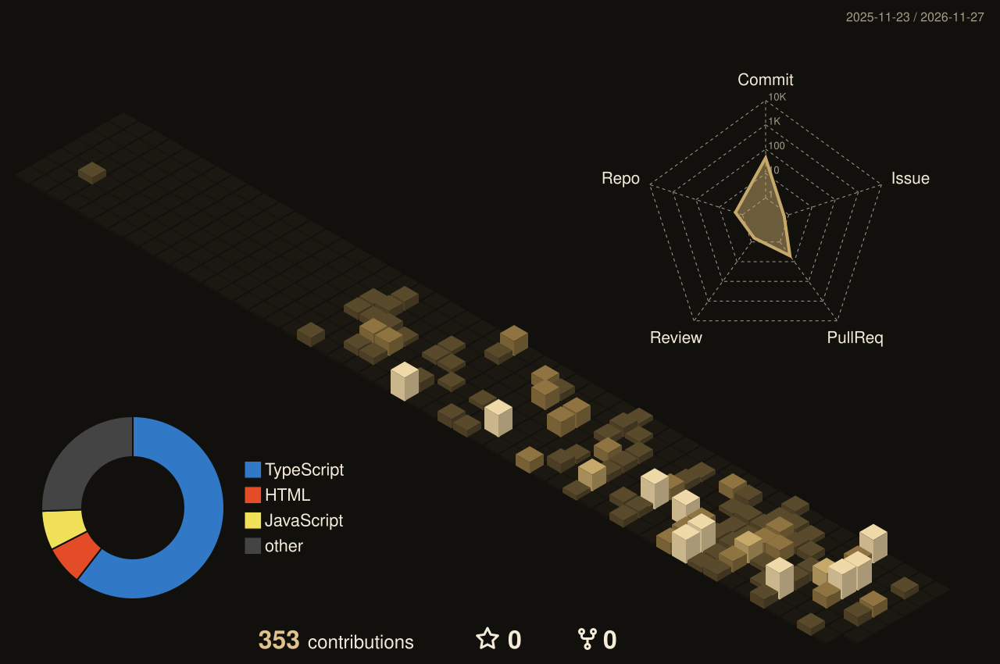
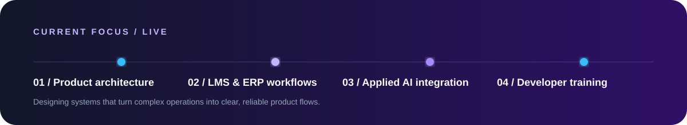

  

  
  
  

## Product Engineering, Applied AI & Developer Training

I build role-aware web products, operational workflows, and polished client platforms with Next.js, SvelteKit, Node.js, Prisma, and PostgreSQL. My AI work is applied: service integrations, AI-assisted product flows, and n8n automation - not model training.

  

## Selected Work

| Area | Projects | Built with |
| --- | --- | --- |
| Education systems | [WebLiquids Campus OS](https://webliquids.com) | Next.js, Prisma, PostgreSQL |
| Client platforms | [CodeClousor](https://codeclousor.com) · [Azule Construction](https://azuleconstruction.au) | Next.js, Motion, Tailwind CSS |
| Service flows | [PsychoWaves](https://psychowaves.org) · [MeMantra](https://memantra.in) · [ScoreLoom](https://scoreloom.com) | SvelteKit, Prisma, JWT, Razorpay |
| Public builds | [Webcodder](https://github.com/DhimanKhushal/webcoder) · [Property in Vrindavan](https://github.com/DhimanKhushal/property-in-vrindavan) · [Doner Factory Mölndal](https://github.com/DhimanKhushal/donerfactorymolndal) | Next.js, TypeScript, React |

## Stack

  

## Contributions

  

  

  

  

<i>Build systems that make the next good decision easier.</i>

